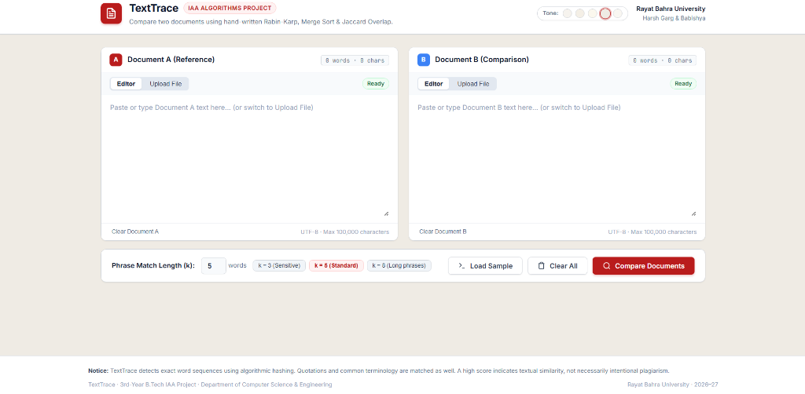
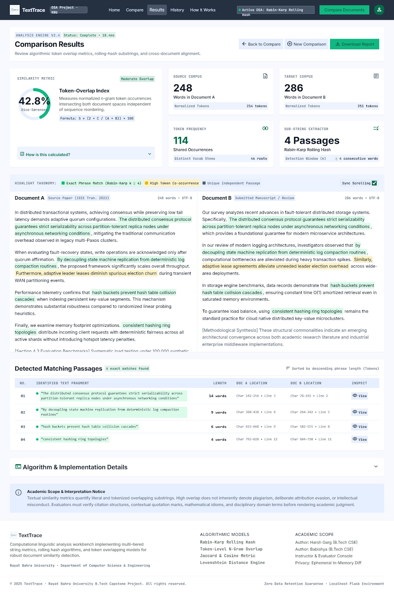
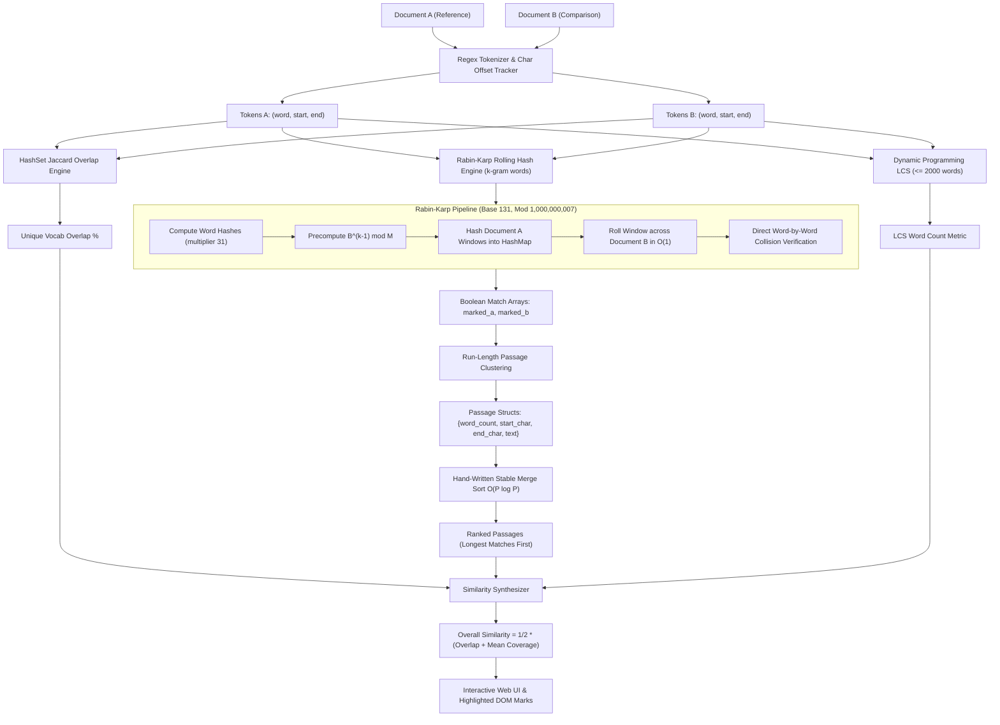

# TextTrace — Algorithmic Document Similarity & Plagiarism Detection Engine

[](https://www.python.org/)
[](https://palletsprojects.com/p/flask/)
[-success?logo=pytest&logoColor=white)](https://docs.pytest.org/)
[]()
[](https://www.docker.com/)
[](https://opensource.org/licenses/MIT)

> **3rd-Year B.Tech Computer Science & Engineering**  
> **Course:** Introduction to Analysis of Algorithms (IAA)  
> **Institution:** Rayat Bahra University  
> **Author:** Harsh Garg  
> **Repository:** [https://github.com/vortex-001/TextTrace](https://github.com/vortex-001/TextTrace)

---

## 📌 Repository Overview

**TextTrace** is a full-stack, algorithm-focused document comparison instrument engineered specifically for **Analysis of Algorithms** viva defense and practical evaluation. It compares two plain-text or multi-format documents (`.txt`, `.docx`, `.pdf`, OCR image inputs) to identify shared sequences, calculate vocabulary overlap, extract contiguous matching passages, and compute mathematical similarity scores.

### 🎯 Hard Algorithmic Constraints (Viva Compliance)
* **100% Hand-Written Core Algorithms**: Rabin-Karp rolling hash, stable divide-and-conquer Merge Sort, tokenizer with character offsets, Jaccard set operations, and Dynamic Programming LCS are written by hand in pure Python.
* **Strictly Zero Black-Box Libraries**: No `difflib`, `sklearn`, `nltk`, `fuzzywuzzy`, `numpy`, or Python's built-in `sorted()` / `list.sort()` for passage ranking.
* **In-Memory & Zero Database Retention**: Documents are processed strictly in RAM ($O(N+M)$ time complexity) using hash tables (`dict`) and hash sets (`set`). Documents are never written to disk or database, guaranteeing complete privacy and zero data retention.

---

## 📸 Application Interface (Live UI)


*TextTrace Live Application: Side-by-side Document A & Document B workspace with word counters, custom phrase length k presets, and algorithmic comparison controls.*

| Algorithmic Similarity Results | Interactive Algorithm Visualizer |
|:---:|:---:|
|  | *Live animated Rabin-Karp sliding window, Merge Sort divide-and-conquer tree, & asymptotic analysis table* |

---

## 🧠 System Architecture & Workflow



---

## ⚡ DSA Algorithms & Mathematical Formulations

### 1. Rabin-Karp Rolling Hash Substring Matching
Rabin-Karp allows finding all matching $k$-word phrases between Document A and Document B in linear average time.

1. **Word Polynomial Hash**:
   Each word string is converted to a 64-bit integer using polynomial rolling hash with multiplier $31$:
   $$H(w) = \left( \sum_{i=0}^{L-1} \text{ord}(w[i]) \cdot 31^{L-1-i} \right) \pmod M$$
   where $M = 1,000,000,007$ ($10^9+7$).

2. **Window Rolling Hash**:
   For a phrase window of length $k$ words:
   $$H_0 = \left( \sum_{j=0}^{k-1} hw[j] \cdot B^{k-1-j} \right) \pmod M$$
   where base $B = 131$.

3. **$O(1)$ Rolling Window Update**:
   When shifting the window from index $i$ to $i+1$, the outgoing leading word $hw[i]$ is evicted and the incoming word $hw[i+k]$ is absorbed in **$O(1)$ constant time**:
   $$H_{i+1} = \left( \left( H_i - hw[i] \cdot B^{k-1} \pmod M \right) \cdot B + hw[i+k] \right) \pmod M$$

4. **Collision Verification**:
   To avoid false positives from hash collisions, when a hash match occurs in the Document A HashMap, an exact word-by-word slice equality check ($words_A[i:i+k] == words_B[j:j+k]$) confirms the match.

---

### 2. Hand-Written Stable Merge Sort (Divide & Conquer)
Matched passages are sorted by length (`word_count`) in descending order so the examiner can see the longest copied sections first.

* **Recurrence Relation**:
  $$T(n) = 2T\left(\frac{n}{2}\right) + O(n) \implies O(P \log P)$$
* **Stability Invariant**:
  Using strict greater-than-or-equal-to comparison (`>=`) during merge ensures that passages of equal length maintain their relative document appearance order.
* **No Built-in Sorts**: Built entirely without Python's `list.sort()` or `sorted()`.

---

### 3. Jaccard Vocabulary Overlap
Measures lexical similarity independent of sequence order using hash sets:
$$J(A, B) = \frac{|A \cap B|}{|A \cup B|} \times 100\%$$
* Intersection $|A \cap B|$: Number of unique words shared between both documents.
* Union $|A \cup B|$: Total unique vocabulary across both documents.

---

### 4. Phrase Coverage & Overall Similarity
* **Phrase Coverage A**:
  $$\text{Coverage}_A = \frac{\sum \text{Words in Matched Passages of A}}{\text{Total Words in A}} \times 100\%$$
* **Phrase Coverage B**:
  $$\text{Coverage}_B = \frac{\sum \text{Words in Matched Passages of B}}{\text{Total Words in B}} \times 100\%$$
* **Overall Similarity**:
  $$\text{Overall} = \frac{\text{Word Overlap} + \frac{\text{Coverage}_A + \text{Coverage}_B}{2}}{2}$$

---

### 5. Dynamic Programming Longest Common Subsequence (LCS)
Finds the longest sequence of words appearing in both documents in sequential (not necessarily contiguous) order:
$$\text{DP}[i][j] = \begin{cases} 
\text{DP}[i-1][j-1] + 1 & \text{if } A[i-1] = B[j-1] \\ 
\max(\text{DP}[i-1][j], \text{DP}[i][j-1]) & \text{otherwise} 
\end{cases}$$
*Evaluated for documents $\le 2000$ words to prevent quadratic memory blowup.*

---

## 📊 Asymptotic Complexity Matrix (Viva Ready)

| Algorithm | Role in TextTrace | Best Case | Average Case | Worst Case | Auxiliary Space |
| :--- | :--- | :--- | :--- | :--- | :--- |
| **Rabin-Karp Rolling Hash** | $k$-gram phrase matching | $O(N + M)$ | $O(N + M)$ | $O(N \times M)$ *(hash collisions)* | $O(N)$ *(HashMap)* |
| **Merge Sort** | Passage ranking (longest first) | $O(P \log P)$ | $O(P \log P)$ | $O(P \log P)$ *(guaranteed)* | $O(P)$ *(temp arrays)* |
| **Jaccard HashSet** | Unique vocabulary overlap | $O(N + M)$ | $O(N + M)$ | $O(N + M)$ | $O(N + M)$ |
| **Dynamic Programming LCS** | Word sequence alignment | $O(N \times M)$ | $O(N \times M)$ | $O(N \times M)$ | $O(N \times M)$ |
| **Regex Tokenizer** | Offset tracking & word extraction | $O(L)$ | $O(L)$ | $O(L)$ | $O(N)$ |

*Where $N = |words_A|$, $M = |words_B|$, $P = |passages|$, $L = \text{character length}$.*

---

## 📁 Project Directory Structure

```
TextTrace/
│
├── frontend/                                # Complete Client Presentation Tier
│   ├── static/                              # Static client files
│   │   ├── style.css                        # UI styling, responsive design & themes
│   │   ├── script.js                        # Client DOM manipulation & DSA visualizer
│   │   └── mock_response.json               # Offline fallback test fixture
│   └── templates/                           # HTML5 view templates
│       └── index.html                       # Semantic user interface & visualizer
│
├── backend/                                 # Complete Python Web & Algorithmic Tier
│   ├── app.py                               # Flask controller configured for frontend/
│   ├── __init__.py                          # Backend package definition
│   └── texttrace/                           # Pure Hand-Written Algorithmic Core
│       ├── __init__.py
│       ├── rabinkarp.py                     # Rabin-Karp rolling hash (B=131, M=10^9+7)
│       ├── mergesort.py                     # Stable Merge Sort O(P log P)
│       ├── preprocess.py                    # Custom regex tokenizer & offset tracker
│       ├── wordcompare.py                   # HashMap frequency & HashSet Jaccard
│       ├── passages.py                      # Boolean run-length passage clustering
│       ├── similarity.py                    # Aggregate similarity & coverage formulas
│       ├── lcs.py                           # Hand-written DP Longest Common Subsequence
│       ├── validate.py                      # Input validation & word-length checks
│       └── extractor.py                     # Text extraction (.txt, .docx, .pdf)
│
├── tests/                                   # Automated Pytest Suite (39 tests)
│   ├── conftest.py                          # Test environment configuration
│   ├── test_api.py                          # End-to-end API tests
│   ├── test_rabinkarp.py                    # Rolling hash verification tests
│   ├── test_mergesort.py                    # Stability and sorting tests
│   ├── test_similarity.py                   # Similarity metric formulas
│   ├── test_validate.py                     # Input constraint validations
│   └── test_wordcompare.py                  # Jaccard set logic
│
├── docs/                                    # Academic Documentation & Viva Guides
│   ├── screenshots/                         # High-resolution UI captures
│   ├── ARCHITECTURE.md                      # Detailed system design & contracts
│   ├── PRD.md                               # Product Requirements Document
│   ├── PROGRESS.md                          # Milestone log
│   └── DEPLOYMENT.md                        # Mobile Wi-Fi & cloud deployment steps
│
├── app.py                                   # Root WSGI entrypoint (delegates to backend)
├── conftest.py                              # Pytest discovery configuration
├── requirements.txt                         # Production dependencies
├── Procfile                                 # Cloud WSGI runner (Gunicorn)
├── Dockerfile                               # Production Docker container
├── run.bat                                  # One-click Windows runner
├── start.bat                                # Windows launcher alias
├── test.bat                                 # One-click Pytest runner
└── .gitignore                               # Git ignore rules
```

---

## 🚀 Quickstart & Installation

### Option 1: One-Click Windows Runner (Recommended)
Simply double-click:
* **`run.bat`** or **`start.bat`**: Automatically sets paths, detects local Wi-Fi IP, starts the Flask server, and launches your browser at `http://127.0.0.1:5000/`.
* **`test.bat`**: Runs all 39 automated unit tests in a dedicated terminal window.

### Option 2: Manual Setup (Windows / macOS / Linux)

```bash
# 1. Clone repository
git clone https://github.com/vortex-001/TextTrace.git
cd TextTrace

# 2. Create and activate virtual environment
python -m venv venv
# Windows:
venv\Scripts\activate
# Linux/macOS:
source venv/bin/activate

# 3. Install dependencies
pip install -r requirements.txt

# 4. Run test suite
python -m pytest -v

# 5. Start Flask development server
python app.py
```
Open **`http://127.0.0.1:5000/`** in your browser.

---

## 🐳 Docker Deployment

To build and run TextTrace as a production Docker container:

```bash
# Build Docker image
docker build -t texttrace .

# Run container on port 5000
docker run -p 5000:5000 texttrace
```
Navigate to **`http://localhost:5000/`**.

---

## 🌐 Cloud Deployment (Render / Railway / Heroku)

TextTrace is 100% cloud-ready:
1. Push repository to GitHub: `https://github.com/vortex-001/TextTrace.git`
2. Connect repository to **Render** or **Railway**.
3. TextTrace includes:
   * **`Procfile`**: `web: gunicorn app:app`
   * **Dynamic Port Binding**: `port = int(os.environ.get("PORT", 5000))`
   * **Host Binding**: `host="0.0.0.0"` for public reverse-proxy access.

---

## 📡 REST API Reference

### 1. Compare Documents
* **Endpoint**: `POST /api/compare`
* **Content-Type**: `application/json`

**Request Payload**:
```json
{
  "text_a": "Data structures help programmers organise information...",
  "text_b": "Many students prefer this approach. Data structures help programmers...",
  "k": 5
}
```

**Response (200 OK)**:
```json
{
  "scores": {
    "overall": 64.58,
    "word_overlap": 55.20,
    "coverage_a": 72.10,
    "coverage_b": 75.80
  },
  "stats": {
    "words_a": 85,
    "words_b": 92,
    "unique_a": 48,
    "unique_b": 51,
    "common_words": 35,
    "union_words": 64,
    "passages_a": 3,
    "passages_b": 3,
    "longest_passage": 14,
    "lcs_length": 42
  },
  "passages_a": [
    {
      "word_count": 14,
      "start_char": 42,
      "end_char": 138,
      "text": "data structures help programmers organise information..."
    }
  ],
  "passages_b": [...]
}
```

---

### 2. Extract Document Text
* **Endpoint**: `POST /api/extract`
* **Content-Type**: `multipart/form-data`
* **Accepted Formats**: `.txt`, `.docx`, `.pdf`

---

## 🎓 Viva Defense Q&A (Examiner Prep)

#### Q1: Why use Rabin-Karp instead of Knuth-Morris-Pratt (KMP) or Boyer-Moore?
> *"Sir, KMP and Boyer-Moore are optimized for single-pattern matching. In document plagiarism detection, we need to compare multiple $k$-word candidate substrings from Document B against all possible $k$-word substrings in Document A. With Rabin-Karp, we hash all substrings of Document A into a hash table in $O(N)$ time, and roll through Document B in $O(1)$ per window, achieving $O(N + M)$ average time for all-against-all multi-pattern matching."*

#### Q2: How do you handle rolling hash collisions?
> *"We use a large prime modulo ($M = 1,000,000,007$) and polynomial base ($B = 131$), making hash collisions rare ($\approx 1/M$). When a hash match occurs in the Document A HashMap, we execute an explicit word-by-word string comparison on the actual tokens before marking the match to guarantee zero false positives."*

#### Q3: Why write Merge Sort by hand instead of using `sorted()`?
> *"Python's built-in `sorted()` implements Timsort. As a core requirement of our IAA curriculum, all divide-and-conquer algorithms must be hand-written. Our custom Merge Sort divides the array at $\lfloor \text{len} / 2 \rfloor$ down to singleton base cases and merges sub-arrays in $O(P \log P)$ time while strictly preserving stability using `>=`."*

#### Q4: Why is there no database?
> *"TextTrace is an in-memory algorithmic instrument. Storing documents in an external database would introduce disk I/O overhead and violate the zero-retention privacy policy for submitted student documents. All operations run in volatile RAM and are cleared upon response."*

---

## 👨‍💻 Author & Academic Credits

* **Developer:** Harsh Garg
* **Degree:** Bachelor of Technology (B.Tech) — Computer Science & Engineering
* **University:** Rayat Bahra University (2026–2027)
* **Course:** Introduction to Analysis of Algorithms (IAA)
